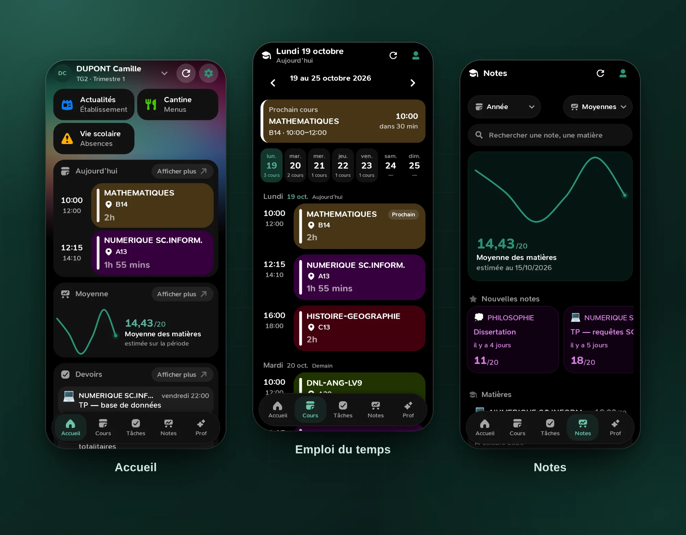

<p align="center">
  
</p>

<h1 align="center">veryslopnynotes</h1>

<p align="center"><strong>Ton Pronote. Ta session. Rien que toi.</strong></p>

<p align="center">
  <a href="LICENSE"></a>
  <a href="shared/contracts/api.openapi.yaml"></a>
  <a href="https://bun.sh"></a>
  
</p>

<p align="center">
  <a href="#installer">Installer</a> ·
  <a href="#vie-privée">Vie privée</a> ·
  <a href="#développer">Développer</a>
</p>

<p align="center">
  
</p>

Un client Android open source pour Pronote. L'app parle directement à
l'établissement et chiffre la session sur l'appareil. Notes, devoirs, emploi du
temps, vie scolaire, messages, cantine, révisions et aide aux devoirs restent
lisibles hors ligne.

> **Pas encore de release.** Le projet est en développement
> (`versionName` `0.1.0`). Aucun APK, tag ni lien de téléchargement n'existe
> aujourd'hui. La page [Releases](https://github.com/iguanacucumber/veryslopnynotes/releases)
> sera la seule source officielle.

## Installer

Quand une release signée sortira : télécharge l'APK depuis
[Releases](https://github.com/iguanacucumber/veryslopnynotes/releases), vérifie
le SHA-256 et le certificat, puis installe-le. N'installe qu'un APK **release
signé** : un APK debug ne reçoit pas les mises à jour.

```bash
sha256sum veryslopnynotes-<version>.apk
apksigner verify --print-certs veryslopnynotes-<version>.apk
```

<details>
<summary>Canal bêta, downgrade et perte de données</summary>

L'app ne vérifie pas les mises à jour. Installe la nouvelle release par-dessus,
avec le même certificat. Android refuse un certificat différent : passer d'un
APK debug à un release demande une désinstallation.

### Canal bêta

Les tags `vX.Y.Z-beta.N` sont des pré-releases signées avec la même clé. Bêta →
bêta et bêta → finale s'installent sans perte. Revenir à une version
antérieure est un **downgrade** : Android le refuse.

Une désinstallation efface la session, le cache, la clé OpenRouter, les
conversations IA, les pièces jointes et les préférences. Exporte d'abord une
copie depuis Réglages (elle n'est pas réimportable), puis ressaisis le QR/PIN
et la clé.

</details>

## Compatibilité

- **Android 8.0+** (API 26), cible API 37 ; **WebView Chromium 100+**.
- **QR + PIN uniquement** ; compte élève uniquement, un à la fois.
- Comptes parent hors périmètre ; pas de rappels ni de notifications ;
  synchro silencieuse toutes les 6 h.
- iOS, desktop et navigateur seul : non pris en charge.

## Vie privée

L'assistant est facultatif. Sans consentement explicite et sans clé, aucun
appel n'est fait. L'écran demande 18 ans ou plus, ou l'accord d'un représentant
légal avec un compte OpenRouter géré par un adulte.

<p align="center">
  
</p>

- La clé OpenRouter est chiffrée sur l'appareil et envoyée directement à
  OpenRouter, jamais à un serveur du projet.
- Question, cours, extraits, pièces jointes et photos peuvent partir chez
  OpenRouter selon l'aperçu de consentement. Les messages Pronote ne font pas
  partie des sources IA.
- Les données scolaires ne passent par un serveur du projet, ni par un relais.
  Pas de compte chez le projet, pas de publicité, pas de télémétrie, pas de
  rapport de crash automatique.
- OpenRouter et ses fournisseurs peuvent conserver les demandes selon leurs
  politiques. Une réponse peut être fausse ; rien ne s'applique sans ton geste.
- La déconnexion ou un changement de compte purge cache, fiches, préférences et
  pièces jointes. « Supprimer toutes mes données » emporte aussi le
  consentement IA, l'adresse du scraper et les exports.

Scraper facultatif : [`server/README.md`](server/README.md).

## Développer

Prérequis : **Bun 1.4.4** ; **JDK 17–21** et **SDK Android 37** ; **`kotlinc`**
et un `java` dans le `PATH` pour la parité TS ↔ Kotlin.

```bash
bun install
bun run dev:web       # interface + pont factice, sans téléphone
make check            # gate complet
make buildDebugApk    # APK debug
make buildRelApk      # APK release signé
```

`make check` est le gate ; `make check-fast` ne le remplace pas. Docs :
[`AGENTS.md`](AGENTS.md), [`docs/architecture/BUILD.md`](docs/architecture/BUILD.md),
modules [`android/README.md`](android/README.md), [`web/README.md`](web/README.md),
[`server/README.md`](server/README.md), invariants
[`I1–I36`](docs/architecture/INVARIANTS.md).

## Support et licence

Support par [issues](https://github.com/iguanacucumber/veryslopnynotes/issues/new/choose)
uniquement : jamais de donnée scolaire, de QR/PIN, de session ni de clé dans une
issue. Faille ou secret exposé :
[advisory privé](https://github.com/iguanacucumber/veryslopnynotes/security/advisories/new).

Code et contributions sous **GPL-3.0-only**. Voir [`LICENSE`](LICENSE),
[ADR-008](docs/adr/008-relicense-gpl.md) et
[`THIRD_PARTY_NOTICES.md`](THIRD_PARTY_NOTICES.md).

Projet indépendant, non affilié à Pronote / Index Éducation ni à Papillon /
Association Papillon, ni à OpenRouter ou à un établissement. Pronote et Index
Éducation sont des marques de leurs titulaires. Le port du protocole vient de
`pronotets` (MIT) ; les règles reprises de Papillon (GPL-3.0, Association
Papillon) restent créditées à leurs auteurs.
