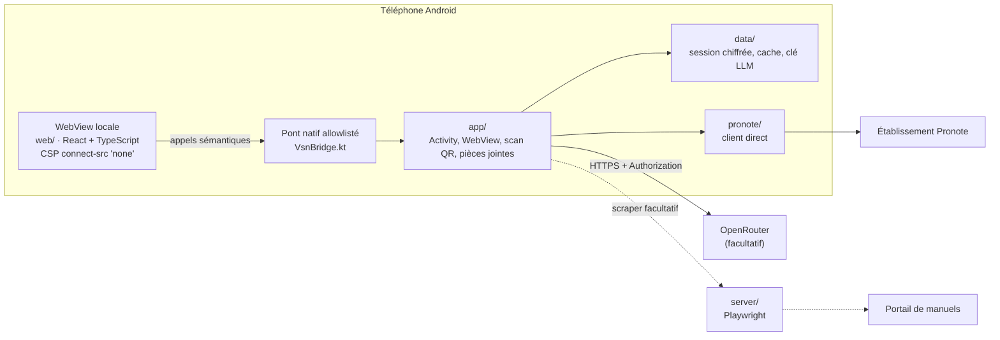

<h1 align="center">veryslopnynotes</h1>

<p align="center"><strong>Ton Pronote. Ta session. Rien que toi.</strong></p>

<p align="center">
  <a href="android/README.md">App Android</a> ·
  <a href="web/README.md">Interface React</a> ·
  <a href="server/README.md">Scraper</a> ·
  <a href="docs/RELEASE.md">Build & release</a> ·
  <a href="docs/architecture/INVARIANTS.md">Invariants</a> ·
  <a href="AGENTS.md">Contribuer</a>
</p>

<p align="center">
  <a href="LICENSE"></a>
  <a href="shared/contracts/api.openapi.yaml"></a>
  <a href="https://bun.sh"></a>
  
</p>

veryslopnynotes est un client Android open source pour Pronote. L'application
parle **directement à l'établissement depuis le téléphone** : aucun serveur
intermédiaire ne voit la session. L'interface React est embarquée dans l'APK, et
tout contenu venu de l'extérieur — cours, devoirs, messages, manuels — est traité
comme une **donnée**, jamais comme une instruction.

Le serveur de ce dépôt est facultatif : il ne sert qu'au scraper de manuels.
Pronote et l'assistant IA fonctionnent sans lui.

> Projet non affilié à Pronote / Index Éducation. L'app utilise un port Kotlin du
> protocole de la bibliothèque communautaire
> [`pronotets`](https://www.npmjs.com/package/pronotets) (MIT), avec un compte et
> une autorisation de l'établissement — à toi de vérifier que cet usage est
> autorisé chez toi.

## Ce qui distingue l'app

- **La session reste sur le téléphone.** Le QR et son PIN sont lus dans l'app ;
  le jeton de session est stocké chiffré sur l'appareil et purgé à la
  déconnexion ([ADR-003](docs/adr/003-client-direct.md)).
- **Aucun serveur applicatif dans le flux.** L'app ne relaie ni session Pronote
  ni clé OpenRouter. Seul `android/pronote/` contacte l'établissement.
- **L'IA n'a ni outils ni secrets.** La clé OpenRouter est chiffrée localement et
  part directement au fournisseur ; le contenu externe est délimité et marqué
  non fiable avant tout prompt ([I4–I6](docs/architecture/INVARIANTS.md)).
- **Hors-ligne d'abord.** Chaque ressource a son cache et son TTL ; l'interface
  affiche le cache avant le réseau et signale les données périmées.
- **Zéro réseau dans la WebView.** CSP `connect-src 'none'`, pas de `fetch`, pas
  de contenu distant. Tout passe par un pont natif allowlisté
  ([ADR-004](docs/adr/004-webview.md)).

## Écrans et fonctionnalités

| Route | Écran | Ce que tu y trouves |
|---|---|---|
| `/pairing` | Appairage | Scan du QR de l'établissement + PIN, session ouverte en direct, sans serveur intermédiaire. |
| `/` | Accueil | Moyenne, dernière note, prochains cours, devoirs à faire, alertes et accès rapides. |
| `/calendar` | Cours | Navigation par semaine, professeur, salle, cours en cours / prochain, annulés et déplacés. |
| `/tasks` | Tâches | Devoirs de la semaine, consigne, pièces jointes, case « fait » écrite dans Pronote, aide IA. |
| `/grades` | Notes | Moyenne du bulletin ou estimée, 3 algorithmes (matières, pondérée, médiane), courbe d'historique, influence de chaque note, périodes. |
| `/attendance` | Vie scolaire | Absences et retards, justifiés / à justifier, heures manquées, compteurs par période. |
| `/sanctions` | Sanctions | Sanctions publiées par l'établissement, gravité et durée. |
| `/messages` | Messagerie | Discussions, recherche, non-lus, réponse, création et suppression. |
| `/news` | Actualités | Fils par catégorie, lecture développée, état lu conservé localement. |
| `/canteen` | Cantine | Menus de la semaine et allergènes. |
| `/fiches` | Fiches de révision | Fiches locales avec sources citées, consultation et export PDF. |
| `/alerts` | Alertes | Contenus hostiles détectés puis neutralisés, affichés en texte brut, avec l'état de la dernière vérification. |
| `/profile` | Profil | Profil du compte, nombre de comptes appairés, déconnexion qui purge session et caches. |
| `/settings` | Réglages | Thème clair / sombre / système, 20 palettes, matières personnalisées (couleur, emoji, libellé), adresse du scraper, clé de l'assistant. |

En plus des écrans :

- **Capacités dynamiques** — les widgets et accès rapides que l'établissement ne
  publie pas sont masqués, au lieu d'afficher des blocs vides.
- **Cache par ressource** — notes, devoirs, emploi du temps, actualités, cantine,
  vie scolaire, sanctions, messagerie, capacités et alertes ont chacun leur TTL
  et leur badge « périmé ». Une erreur réseau n'efface pas ce qui est déjà
  lisible.
- **Synchronisation de fond** — WorkManager rafraîchit notes, devoirs et emploi
  du temps toutes les 6 h (réseau connecté, batterie suffisante) et réécrit le
  cache partagé avec l'interface, sans serveur ni push.
- **Accessibilité** — libellés ARIA, contrastes vérifiés dans les palettes
  claire et sombre, `prefers-reduced-motion` respecté.
- **Aide devoirs sourcée** — la réponse vient de la consigne et du cours du
  devoir ; sans source suffisante, l'assistant refuse au lieu d'inventer.

## Comment ça marche



Le serveur n'est **jamais** dans le flux Pronote ni dans celui de l'assistant.
Il ne reçoit que les identifiants du portail et une URL de départ, dans le corps
de la requête, pour scraper une page de manuel.

### Ce qui ne quitte pas le téléphone

- Le **PIN** déchiffre le QR en mémoire et n'est jamais persisté ; seul le jeton
  tourné est stocké chiffré (`SessionStore`, `EncryptedSharedPreferences`).
- La **clé OpenRouter** est chiffrée au repos et envoyée directement au
  fournisseur dans l'en-tête HTTPS `Authorization`.
- Le **profil** reste en mémoire ; les caches ne contiennent que les données
  nécessaires au fonctionnement hors-ligne.
- Une **déconnexion** invalide la session et purge tous les caches locaux.

## Démarrage rapide

### Prérequis

- [Bun](https://bun.sh) **1.4.3**
- Pour l'APK : **JDK 17–21** et **SDK Android 37**
  (`platforms;android-37.0`, `build-tools;36.0.0`, `platform-tools`)
- Un téléphone **Android 8.0+** (API 26)

Les commandes Gradle trouvent le JDK et le SDK toutes seules, et **échouent**
si l'outillage manque : un APK demandé en silence n'en est pas un. `make check`
signale au contraire un SKIP bruyant quand la compilation Kotlin n'a pas pu
tourner.

### Interface seule, sans téléphone

```bash
git clone https://github.com/iguanacucumber/veryslopnynotes.git
cd veryslopnynotes
bun install
bun run dev:web       # Chromium + pont factice (src/bridge/mock.ts)
bun run typecheck:web
bun run build:web     # écrit dans android/app/src/main/assets/web/
```

Le pont factice imite les payloads réels : les écrans se développent sans
session Pronote ni appareil.

### APK

```bash
make check             # toutes les vérifications, en parallèle
make buildDebugApk     # APK debug -> android/app/build/outputs/apk/debug/
make updateApkToPhone  # construire puis installer en conservant les données
make buildRelApk       # APK + AAB release (signés ; custom si STORE_FILE)
```

L'interface React est reconstruite **avant** Gradle (`preBuild` →
`bun run build:web`) : un build APK sans `bun` échoue bruyamment plutôt que
d'embarquer une UI absente. Détails : [`android/README.md`](android/README.md)
et [`docs/RELEASE.md`](docs/RELEASE.md).

### Scraper de manuels (facultatif)

```bash
make runServer         # HTTPS sur 0.0.0.0:8080
```

`make runServer` génère un certificat auto-signé hors du dépôt
(`~/.cache/veryslopnynotes/tls`). Fournis `TLS_CERT_FILE` et `TLS_KEY_FILE`
pour un certificat émis (mkcert, Let's Encrypt). Le serveur ne relaie ni
session Pronote ni clé OpenRouter.

> **Sécurité :** `POST /v1/manuals/scrape` est volontairement sans
> authentification. Il reçoit des identifiants éditeur et une URL dans le corps
> de la requête, et pilote Playwright : toute personne pouvant joindre le
> serveur peut s'en servir (SSRF) et consommer le compte du portail. Garde-le
> sur la boucle locale ou un réseau de confiance, ou place un proxy authentifié
> devant. Voir [I8](docs/architecture/INVARIANTS.md).

## Commandes

| Commande | Rôle |
|---|---|
| `make check` | Secrets, typecheck, tests unitaires, architecture, contrats, garde-fou Kotlin, compilation Kotlin réelle et frontend — en parallèle. |
| `make check-fast` | Boucle interne (~2,1 s à chaud) sans Gradle ; le build Vite est inclus, jamais le gate de merge. |
| `make watch` | Relance les tests unitaires + web à chaque changement (`T=tests/unit/foo.test.ts` pour cibler). |
| `make web` | Typecheck + tests + build de l'interface React. |
| `make unit` | Tests unitaires (`tests/unit`). |
| `make contracts` | Tests des contrats partagés. |
| `make architecture-test` | Scans d'architecture + invariants. |
| `make check-kotlin` | Garde-fou structurel Kotlin, sans SDK ni réseau. |
| `make android-compile` | Vraie compilation Kotlin (le seul contrôle des symboles et surcharges). |
| `make web-smoke` | Test navigateur du frontend (Chromium requis), hors `make check`. |
| `make buildDebugApk` / `make buildRelApk` | APK debug / APK + AAB release. |
| `make updateApkToPhone` | APK debug puis `adb install -r` (données conservées). |
| `make shot ROUTE=grades` | Capture vérifiée sur téléphone réel (`SHOT_ARGS="--theme dark"` pour le thème). |
| `make runServer` | Scraper de manuels HTTPS sur `:8080`. |
| `make build` | Vérification des secrets + image Docker du serveur (skip si Docker est absent). |

## Tests et qualité

```bash
make check
make unit
make contracts
make architecture-test
bun audit
```

Les tests Bun par défaut utilisent des **fixtures synthétiques** et ne font aucun
accès réseau. Le corpus Pronote de `tests/fixtures/pronote/` est gitignoré : s'il
existe localement, il contient des données personnelles et ne doit jamais être
publié. Les captures de `shots/` sont également gitignorées (elles montrent le
vrai nom et les vraies notes d'un élève) ; `make shot` les rejoue et vérifie que
l'écran demandé a bien été atteint.

Un changement qui casse un invariant est **bloquant**, même s'il passe
fonctionnellement. Les captures et les tests de bout en bout sur un compte réel
ne font pas partie de la suite par défaut.

## Configuration

**Pas de `.env` ni de secret côté serveur.** Le QR contient l'adresse de
l'établissement ; le PIN et la session restent sur le téléphone.

| Variable | Usage | Secrète ? |
|---|---|---|
| `PORT`, `HOST` | Écoute du scraper. `make runServer` force `8080` et `0.0.0.0` ; sans `HOST`, le binaire écoute sur la boucle locale. | Non |
| `TLS_CERT_FILE`, `TLS_KEY_FILE` | Certificat et clé du scraper. | Non (chemins) |
| `SERVER_HOST` ou `server.host` dans `android/local.properties` | Graine de l'adresse du scraper ; l'adresse se change ensuite dans l'app. | Non |
| `STORE_FILE`, `STORE_PASSWORD`, `KEY_ALIAS`, `KEY_PASSWORD` | Signature release, toujours hors du dépôt. | **Oui** |
| `ANDROID_HOME`, `ANDROID_JDK_HOME` | Découverte du SDK et du JDK. | Non |

Variables et apports humains : [`docs/HUMAN_INPUTS.md`](docs/HUMAN_INPUTS.md).

## Structure du dépôt

```text
├─ android/          APK, Activity + WebView, pont natif, modules core/data/pronote
├─ web/              interface React/TypeScript embarquée (zéro réseau)
├─ server/           scraper de manuels facultatif (Playwright, HTTPS)
├─ shared/contracts/ routes du scraper, OpenAPI et validateurs gardés pour les tests
├─ agents/           vérifications, captures et harnais de test locaux
├─ tests/            tests unitaires, contrats et architecture
├─ site/             page de présentation animée (vanilla, hors ligne)
└─ docs/             ADR, invariants, recette, release, apports humains
```

Flux Pronote : `web (pont) → android/pronote/ → établissement`. Le serveur n'est
pas dans ce flux. Règles détaillées :
[`docs/architecture/INVARIANTS.md`](docs/architecture/INVARIANTS.md).

## Documentation

- [`docs/architecture/INVARIANTS.md`](docs/architecture/INVARIANTS.md) — règles
  critiques (I1–I10) et tests qui les pinent.
- [`docs/adr/`](docs/adr/) — décisions d'architecture : stack, client direct,
  WebView locale.
- [`docs/RELEASE.md`](docs/RELEASE.md) — versions épinglées, build, signature,
  livrable.
- [`docs/RECETTE.md`](docs/RECETTE.md) — recette des 14 routes, thèmes, grande
  police, hors-ligne.
- [`docs/HUMAN_INPUTS.md`](docs/HUMAN_INPUTS.md) — ce qui doit être fourni à la
  main, sans valeur secrète.
- [`android/README.md`](android/README.md) — modules, appairage QR, certificat
  de développement, build.
- [`web/README.md`](web/README.md) — contrat du pont, budget, structure.
- [`server/README.md`](server/README.md) — routes et limites du scraper.

## Contribuer

Le circuit du dépôt est **une issue = une branche = une PR**
(`agent/<n>-<slug>`), sans commit direct sur `main`. PR via MCP GitHub
uniquement (`gh` CLI interdit), relecture du diff et `make check` avant merge.
Un invariant cassé rend la PR bloquante.

```bash
./agents/launch.sh 343 faster-flow   # worktree depuis origin/main, deps, claim
make watch                            # boucle TDD
./agents/ship.sh 343 "agents: ..."   # rebase + check + push + corps de PR
```

- [`AGENTS.md`](AGENTS.md) — workflow, garde-fous, règles d'or.
- [`docs/adr/`](docs/adr/) — contexte des choix d'architecture.

Toute nouvelle dépendance doit être justifiée dans la PR, épinglée, auditée avec
`bun audit` et compatible MIT. Aucun secret, aucune donnée personnelle, aucune
capture réelle dans le dépôt.

## État et limites

Le projet est en développement (`versionName` `0.1.0`) et aucune release n'est
publiée à ce jour. Les limites connues sont documentées et assumées :

- l'accès Pronote dépend de l'établissement, du QR fourni et de l'autorisation
  d'usage ;
- l'assistant IA est inactif sans clé OpenRouter ;
- le scraper de manuels n'a pas d'authentification par conception et ne doit pas
  être exposé publiquement ;
- la suite par défaut ne teste pas de compte Pronote réel ; la recette hors-ligne
  et les fixtures synthétiques couvrent les états reproductibles.

## License

MIT — voir [`LICENSE`](LICENSE). Identité et écrans propres ; le port du
protocole Pronote est crédité à `pronotets` (MIT) dans les sources.

<!-- vim: set tw=80: -->
