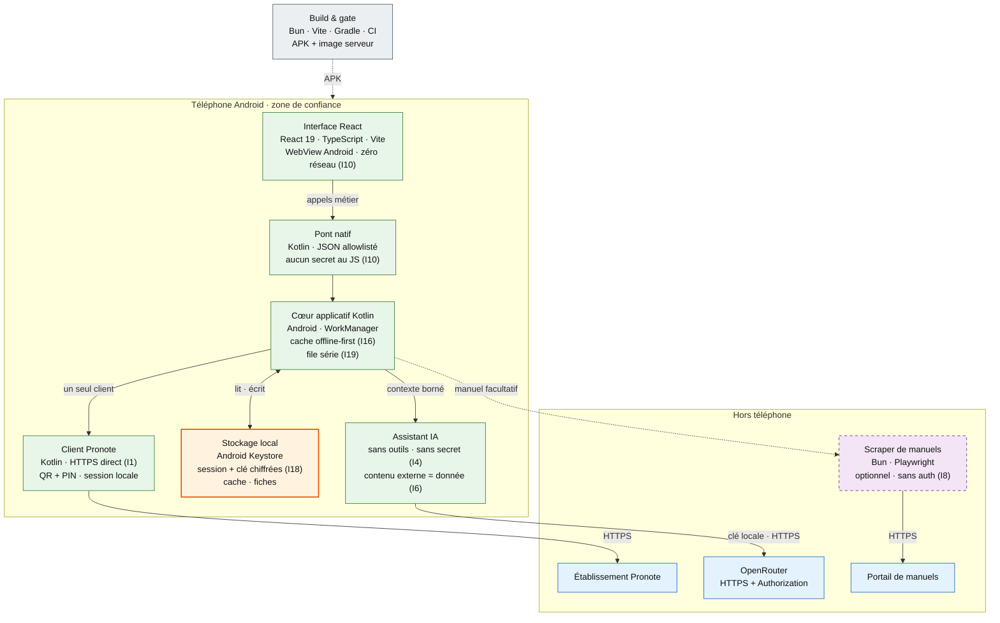

<h1 align="center">veryslopnynotes</h1>

<p align="center"><strong>Ton Pronote. Ta session. Rien que toi.</strong></p>

<p align="center">
  <a href="android/README.md">App Android</a> ·
  <a href="web/README.md">Interface React</a> ·
  <a href="server/README.md">Scraper</a> ·
  <a href="docs/RELEASE.md">Build & release</a> ·
  <a href="docs/architecture/INVARIANTS.md">Invariants</a> ·
  <a href="AGENTS.md">Contribuer</a>
</p>

<p align="center">
  <a href="LICENSE"></a>
  <a href="shared/contracts/api.openapi.yaml"></a>
  <a href="https://bun.sh"></a>
  
</p>

veryslopnynotes est un client Android open source pour Pronote. L'application
parle **directement à l'établissement depuis le téléphone** : aucun serveur
intermédiaire ne voit la session. L'interface React est embarquée dans l'APK, et
tout contenu venu de l'extérieur — cours, devoirs, messages, manuels — est traité
comme une **donnée**, jamais comme une instruction.

Le serveur de ce dépôt est facultatif : il ne sert qu'au scraper de manuels.
Pronote et l'assistant IA fonctionnent sans lui.

> Projet non affilié à Pronote / Index Éducation. L'app utilise un port Kotlin du
> protocole de la bibliothèque communautaire
> [`pronotets`](https://www.npmjs.com/package/pronotets) (MIT), avec un compte et
> une autorisation de l'établissement — à toi de vérifier que cet usage est
> autorisé chez toi.

## Ce qui distingue l'app

- **La session reste sur le téléphone.** Le QR et son PIN sont lus dans l'app ;
  le jeton de session est stocké chiffré sur l'appareil et purgé à la
  déconnexion ([ADR-003](docs/adr/003-client-direct.md)).
- **Aucun serveur applicatif dans le flux.** L'app ne relaie ni session Pronote
  ni clé OpenRouter. Seul `android/pronote/` contacte l'établissement.
- **L'IA n'a ni outils ni secrets.** La clé OpenRouter est chiffrée localement et
  part directement au fournisseur ; le contenu externe est délimité et marqué
  non fiable avant tout prompt ([I4–I6](docs/architecture/INVARIANTS.md)).
- **Hors-ligne d'abord.** Chaque ressource a son cache et son TTL ; l'interface
  affiche le cache avant le réseau et signale les données périmées.
- **Zéro réseau dans la WebView.** CSP `connect-src 'none'`, pas de `fetch`, pas
  de contenu distant. Tout passe par un pont natif allowlisté
  ([ADR-004](docs/adr/004-webview.md)).

## Écrans et fonctionnalités

| Route | Écran | Ce que tu y trouves |
|---|---|---|
| `/pairing` | Appairage | Scan du QR de l'établissement + PIN, session ouverte en direct, sans serveur intermédiaire. Un bouton « Connexion démo » ouvre l'établissement de démonstration public, sans QR ni PIN. |
| `/` | Accueil | Moyenne, dernière note, prochains cours, devoirs à faire, alertes et accès rapides. |
| `/calendar` | Cours | Navigation par semaine, professeur, salle, cours en cours / prochain, annulés et déplacés. |
| `/tasks` | Tâches | Devoirs de la semaine, consigne, pièces jointes, case « fait » écrite dans Pronote, aide IA, photo d’énoncé et création d'une fiche de révision. |
| `/grades` | Notes | Moyenne du bulletin ou estimée, 3 algorithmes (matières, pondérée, médiane), courbe d'historique, influence de chaque note, périodes. |
| `/attendance` | Vie scolaire | Absences et retards, justifiés / à justifier, heures manquées, compteurs par période. |
| `/sanctions` | Sanctions | Sanctions publiées par l'établissement, gravité et durée. |
| `/messages` | Messagerie | Discussions, recherche, non-lus, réponse, création et suppression. |
| `/news` | Actualités | Fils par catégorie, lecture développée, état lu conservé localement. |
| `/canteen` | Cantine | Menus de la semaine et allergènes. |
| `/revision-sheets` | Fiches de révision | Fiches générées depuis un devoir, sources citées, consultation et export PDF. |
| `/course-notes` | Cahier de cours | Cours mémorisés par matière (texte ou photo transcrite), réutilisés comme sources par l’assistant, avec manuel activable matière par matière. |
| `/alerts` | Alertes | Contenus hostiles détectés puis neutralisés, affichés en texte brut, avec l'état de la dernière vérification. |
| `/profile` | Profil | Compte actif, comptes liés publiés par l'établissement, changement d'appairage et déconnexion qui purge session et caches. |
| `/settings` | Réglages | Thème clair / sombre / système, 21 palettes, matières personnalisées (couleur, emoji, libellé), adresse du scraper, adresse du manuel, clé de l'assistant. |

Les anciennes routes `/fiches` et `/cahier` restent des alias.

En plus des écrans :

- **Capacités dynamiques** — les widgets et accès rapides que l'établissement ne
  publie pas sont masqués, au lieu d'afficher des blocs vides.
- **Cache par ressource** — notes, devoirs, emploi du temps, actualités, cantine,
  vie scolaire, sanctions, messagerie, capacités et alertes ont chacun leur TTL
  et leur badge « périmé ». Une erreur réseau n'efface pas ce qui est déjà
  lisible.
- **Cahier de cours local** — les cours sont gardés par matière sur le
  téléphone, puis envoyés au fournisseur avec la clé de l’assistant uniquement
  quand une aide est demandée. Ils sont purgés avec les données du compte.
- **Synchronisation de fond** — WorkManager rafraîchit notes, devoirs et emploi
  du temps toutes les 6 h (réseau connecté, batterie suffisante) et réécrit le
  cache partagé avec l'interface, sans serveur ni push.
- **Accessibilité** — libellés ARIA, contrastes vérifiés dans les palettes
  claire et sombre, `prefers-reduced-motion` respecté.
- **Aide devoirs sourcée** — la réponse vient de la consigne, du cours du
  devoir et, si tu l'as enregistré une fois, d'un extrait de ton manuel ; sans
  source suffisante, l'assistant refuse au lieu d'inventer.
- **Connexion en un clic** — l'établissement de démonstration public de
  l'éditeur s'ouvre sans QR ni PIN : un bouton, une session. Le compte est
  public (l'éditeur le publie sur son site de démonstration) et ne contient
  aucune donnée personnelle ; la session s'ouvre par le pont natif, comme
  n'importe quel appairage.

## Comment ça marche



**Légende** — trait plein : appel à l'exécution ; pointillés : optionnel ou
build ; vert : téléphone ; orange : session et clé sensibles ; violet : service
optionnel ; bleu : service externe ; gris : livraison ; `Ix` : invariant couvert
par un test. Le scraper ne reçoit qu'une plateforme et une URL de départ : ni
session Pronote, ni clé LLM.

Le serveur n'est **jamais** dans le flux Pronote ni dans celui de l'assistant.
Il ne reçoit que la plateforme et une URL de départ, dans le corps de la
requête, pour scraper une page de manuel. Il ne s'authentifie pas : sa session
est son cookie jar local, et les identifiants de portail reçus dans le corps
sont refusés.

### Ce qui ne quitte pas le téléphone

- Le **PIN** déchiffre le QR en mémoire et n'est jamais persisté ; seul le jeton
  tourné est stocké chiffré (`SessionStore`, `EncryptedSharedPreferences`).
- La **clé OpenRouter** est chiffrée au repos et envoyée directement au
  fournisseur dans l'en-tête HTTPS `Authorization`.
- Le **profil** reste en mémoire ; les caches ne contiennent que les données
  nécessaires au fonctionnement hors-ligne.
- Une **déconnexion** invalide la session, purge tous les caches locaux et
  renvoie vers l'appairage : l'accueil d'un compte déconnecté n'est plus
  accessible.

## Démarrage rapide

### Prérequis

- [Bun](https://bun.sh) **1.4.4**
- Pour l'APK : **JDK 17–21** et **SDK Android 37**
  (`platforms;android-37.0`, `build-tools;36.0.0`, `platform-tools`)
- Pour la **parité TS ↔ Kotlin** (la suite qui *exécute* le port Kotlin) :
  le compilateur **`kotlinc`** (même version que le catalogue Gradle) et un
  `java` dans le `PATH`. Sans eux, toute la parité saute — donc `make check`
  les **exige** (un gate vert sans une ligne de Kotlin exécutée est un faux
  vert). `make check-fast` garde le saut bruyant, pour l'itération.
- Un téléphone **Android 8.0+** (API 26)

Les commandes Gradle trouvent le JDK et le SDK toutes seules, et **échouent**
si l'outillage manque : un APK demandé en silence n'en est pas un. `make check`
**échoue** lui aussi quand la compilation Kotlin n'a pas pu tourner (c'est le
seul filet qui résout les symboles) : `ALLOW_SKIP_ANDROID=1` assume
explicitement ce saut, hors merge.

### Interface seule, sans téléphone

```bash
git clone https://github.com/iguanacucumber/veryslopnynotes.git
cd veryslopnynotes
bun install
bun run dev:web       # Chromium + pont factice (src/bridge/mock.ts)
bun run typecheck:web
bun run build:web     # écrit dans android/app/src/main/assets/web/
```

Le pont factice imite les payloads réels : les écrans se développent sans
session Pronote ni appareil.

### APK

```bash
make check             # toutes les vérifications, en parallèle
make buildDebugApk     # APK debug -> android/app/build/outputs/apk/debug/
make updateApkToPhone  # construire puis installer en conservant les données
make buildRelApk       # APK + AAB release (signés ; custom si STORE_FILE)
```

L'interface React est reconstruite **avant** Gradle (`preBuild` →
`bun run build:web`) : un build APK sans `bun` échoue bruyamment plutôt que
d'embarquer une UI absente. Détails : [`android/README.md`](android/README.md)
et [`docs/RELEASE.md`](docs/RELEASE.md).

### Scraper de manuels (facultatif)

```bash
make runServer            # HTTPS sur 127.0.0.1:8080 (boucle locale)
make runServer HOST=0.0.0.0   # pour joindre le scraper depuis le téléphone
```

`make runServer` génère un certificat auto-signé hors du dépôt
(`~/.cache/veryslopnynotes/tls`) **seulement si** `TLS_CERT_FILE` et
`TLS_KEY_FILE` ne sont pas fournis : un couple fourni (mkcert, Let's Encrypt)
est servi tel quel, sans openssl. La préparation TLS est obligatoire — si elle
échoue, le lancement s'arrête, jamais de repli en clair. `PORT` et `HOST`
restent surchargeables (`PORT=9090 make runServer`). Le serveur ne relaie ni
session Pronote ni clé OpenRouter.

L'app demande **une seule fois** l'adresse du manuel (et la garde modifiable
dans Réglages). L'adresse par défaut est le catalogue
`https://www.lelivrescolaire.fr/manuels` : l'app devine la classe depuis le
profil et les spécialités depuis les matières suivies, puis choisit l'ouvrage
correspondant à la matière du devoir. Si l'ouvrage n'existe pas dans sa table,
elle n'ajoute aucune source plutôt que d'en citer un mauvais. Le texte récupéré
est une donnée citée ; l'adresse elle-même ne part jamais vers l'établissement
ni vers le fournisseur LLM.

> **Sécurité :** `POST /v1/manuals/scrape` est volontairement sans
> authentification. Il reçoit une plateforme et une URL dans le corps de la
> requête, et pilote Playwright : toute personne pouvant joindre le
> serveur peut s'en servir (SSRF) et consommer le compte du portail. Garde-le
> sur la boucle locale ou un réseau de confiance, ou place un proxy authentifié
> devant. Voir [I8](docs/architecture/INVARIANTS.md).

## Tests, workflow et commandes

Une seule source : [`AGENTS.md`](AGENTS.md). Il porte les 5 lois, le workflow
issue → branche → PR, le gate (`make check`), les commandes `make` et les règles
de dépendance. Rien n'est recopié ici ; le catalogue exhaustif des cibles est le
`Makefile`.

## Configuration

Variables d'environnement, signature release, corpus d'outillage et apports
humains (QR, clé OpenRouter, manuel, page web) :
[`docs/HUMAN_INPUTS.md`](docs/HUMAN_INPUTS.md). Une seule source, sans valeur
secrète.

## Structure du dépôt

```text
├─ android/          APK, Activity + WebView, pont natif, modules core/data/pronote
├─ web/              interface React/TypeScript embarquée (zéro réseau)
├─ server/           scraper de manuels facultatif (Playwright, HTTPS)
├─ shared/contracts/ routes du scraper, OpenAPI et validateurs gardés pour les tests
├─ agents/           vérifications, captures et harnais de test locaux
├─ tests/            tests unitaires, contrats et architecture
└─ docs/             ADR, invariants, release, configuration
```

Flux Pronote : `web (pont) → android/pronote/ → établissement`. Le serveur n'est
pas dans ce flux. Règles détaillées :
[`docs/architecture/INVARIANTS.md`](docs/architecture/INVARIANTS.md).

## Documentation

- [`docs/architecture/INVARIANTS.md`](docs/architecture/INVARIANTS.md) — index
  des invariants (I1–I35) et tests qui les pinent ; le détail est découpé par
  thème dans [`docs/architecture/invariants/`](docs/architecture/invariants/).
- [`docs/adr/`](docs/adr/) — décisions d'architecture : stack, client direct,
  WebView locale, règles et architecture ([ADR-005](docs/adr/005-rules-and-architecture.md)).
- [`docs/RELEASE.md`](docs/RELEASE.md) — versions épinglées, build, signature,
  livrable.
- [`docs/HUMAN_INPUTS.md`](docs/HUMAN_INPUTS.md) — configuration et apports
  humains, sans valeur secrète.
- [`android/README.md`](android/README.md) — modules, appairage QR, certificat
  de développement, build.
- [`web/README.md`](web/README.md) — contrat du pont, budget, structure.
- [`server/README.md`](server/README.md) — routes et limites du scraper.

## Contribuer

Workflow, branches, gate, commandes et règles de dépendance :
[`AGENTS.md`](AGENTS.md). Décisions : [`docs/adr/`](docs/adr/).

## État et limites

Le projet est en développement (`versionName` `0.1.0`) et aucune release n'est
publiée à ce jour. Les limites connues sont documentées et assumées :

- l'accès Pronote dépend de l'établissement, du QR fourni et de l'autorisation
  d'usage ;
- l'assistant IA est inactif sans clé OpenRouter ;
- le scraper de manuels n'a pas d'authentification par conception et ne doit pas
  être exposé publiquement ;
- la suite par défaut ne teste pas de compte Pronote réel ; les fixtures
  synthétiques et les états hors-ligne rejoués par les tests couvrent le reste.

## License

MIT — voir [`LICENSE`](LICENSE). Identité et écrans propres ; le port du
protocole Pronote est crédité à `pronotets` (MIT) dans les sources.

<!-- vim: set tw=80: -->
