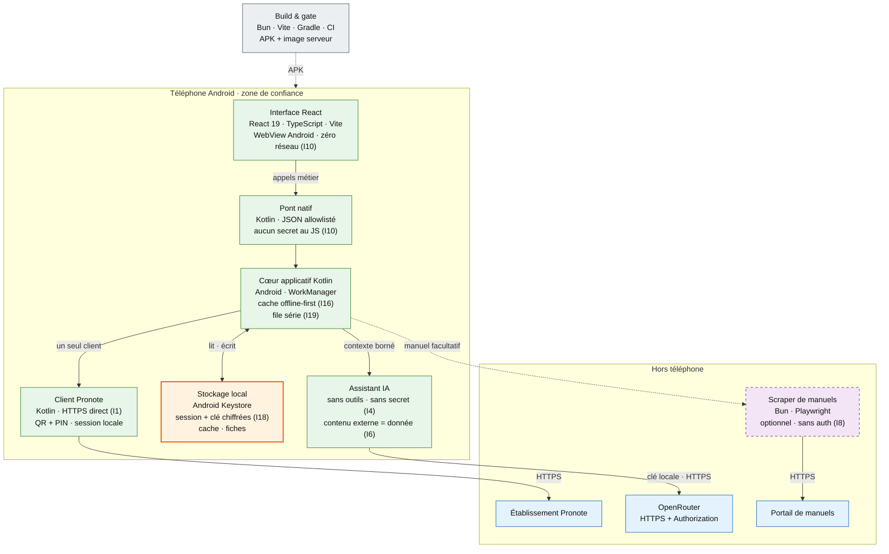

# PRODUCT.md — visite produit

Écrans, comportement et architecture de l'interface. Pour contribuer, voir
`AGENTS.md`.

## Écrans et fonctionnalités

| Route | Écran | Ce que tu y trouves |
|---|---|---|
| `/pairing` | Appairage | Scan du QR de l'établissement + PIN, session ouverte en direct, sans serveur intermédiaire. Un bouton « Connexion démo » ouvre l'établissement de démonstration public, sans QR ni PIN. |
| `/` | Accueil | Moyenne, dernière note, prochains cours, devoirs à faire, alertes et accès rapides. |
| `/calendar` | Cours | Navigation par semaine, professeur, salle, cours en cours / prochain, annulés et déplacés. |
| `/tasks` | Tâches | Devoirs de la semaine, consigne, pièces jointes, case « fait » écrite dans Pronote, aide IA, photo d'énoncé et création d'une fiche de révision. |
| `/grades` | Notes | Moyenne du bulletin ou estimée, 3 algorithmes (matières, pondérée, médiane), courbe d'historique, influence de chaque note, périodes. |
| `/attendance` | Vie scolaire | Absences et retards, justifiés / à justifier, heures manquées, compteurs par période. |
| `/sanctions` | Sanctions | Sanctions publiées par l'établissement, gravité et durée. |
| `/messages` | Messagerie | Discussions, recherche, non-lus, réponse, création et suppression. |
| `/news` | Actualités | Fils par catégorie, lecture développée, état lu conservé localement. |
| `/canteen` | Cantine | Menus de la semaine et allergènes. |
| `/revision-sheets` | Fiches de révision | Fiches générées depuis un devoir, sources citées, consultation et export PDF. |
| `/course-notes` | Cahier de cours | Cours mémorisés par matière (texte ou photo transcrite), réutilisés comme sources par l'assistant, avec manuel activable matière par matière. |
| `/alerts` | Alertes | Contenus hostiles détectés puis neutralisés, affichés en texte brut, avec l'état de la dernière vérification. |
| `/profile` | Profil | Compte actif, comptes liés publiés par l'établissement, changement d'appairage et déconnexion qui purge session et caches. |
| `/settings` | Réglages | Thème clair / sombre / système, 21 palettes, matières personnalisées (couleur, emoji, libellé), adresse du scraper, adresse du manuel, clé de l'assistant. |

Les anciennes routes `/fiches` et `/cahier` restent des alias.

En plus des écrans :

- **Capacités dynamiques** — les widgets et accès rapides que l'établissement ne publie pas sont masqués, au lieu d'afficher des blocs vides.
- **Cache par ressource** — notes, devoirs, emploi du temps, actualités, cantine, vie scolaire, sanctions, messagerie, capacités et alertes ont chacun leur TTL et leur badge « périmé ». Une erreur réseau n'efface pas ce qui est déjà lisible.
- **Cahier de cours local** — les cours sont gardés par matière sur le téléphone, puis envoyés au fournisseur avec la clé de l'assistant uniquement quand une aide est demandée. Ils sont purgés avec les données du compte.
- **Synchronisation de fond** — WorkManager rafraîchit notes, devoirs et emploi du temps toutes les 6 h (réseau connecté, batterie suffisante) et réécrit le cache partagé avec l'interface, sans serveur ni push.
- **Accessibilité** — libellés ARIA, contrastes vérifiés dans les palettes claire et sombre, `prefers-reduced-motion` respecté.
- **Aide devoirs sourcée** — la réponse vient de la consigne, du cours du devoir et, si tu l'as enregistré une fois, d'un extrait de ton manuel ; sans source suffisante, l'assistant refuse au lieu d'inventer.
- **Connexion en un clic** — l'établissement de démonstration public de l'éditeur s'ouvre sans QR ni PIN : un bouton, une session. Le compte est public (l'éditeur le publie sur son site de démonstration) et ne contient aucune donnée personnelle ; la session s'ouvre par le pont natif, comme n'importe quel appairage.

## Comment ça marche

**Légende** — trait plein : appel à l'exécution ; pointillés : optionnel ou
build ; vert : téléphone ; orange : session et clé sensibles ; violet : service
optionnel ; bleu : service externe ; gris : livraison ; `Ix` : invariant couvert
par un test. Le scraper ne reçoit qu'une plateforme et une URL de départ : ni
session Pronote, ni clé LLM.

Le serveur n'est **jamais** dans le flux Pronote ni dans celui de l'assistant.
Il ne reçoit que la plateforme et une URL de départ, dans le corps de la
requête, pour scraper une page de manuel. Il ne s'authentifie pas : sa session
est son cookie jar local, et les identifiants de portail reçus dans le corps
sont refusés.

### Ce qui ne quitte pas le téléphone

- Le **PIN** déchiffre le QR en mémoire et n'est jamais persisté ; seul le jeton
  tourné est stocké chiffré (`SessionStore`, `EncryptedSharedPreferences`).
- La **clé OpenRouter** est chiffrée au repos et envoyée directement au
  fournisseur dans l'en-tête HTTPS `Authorization`.
- Le **profil** reste en mémoire ; les caches ne contiennent que les données
  nécessaires au fonctionnement hors-ligne.
- Une **déconnexion** invalide la session, purge tous les caches locaux et
  renvoie vers l'appairage : l'accueil d'un compte déconnecté n'est plus
  accessible.
